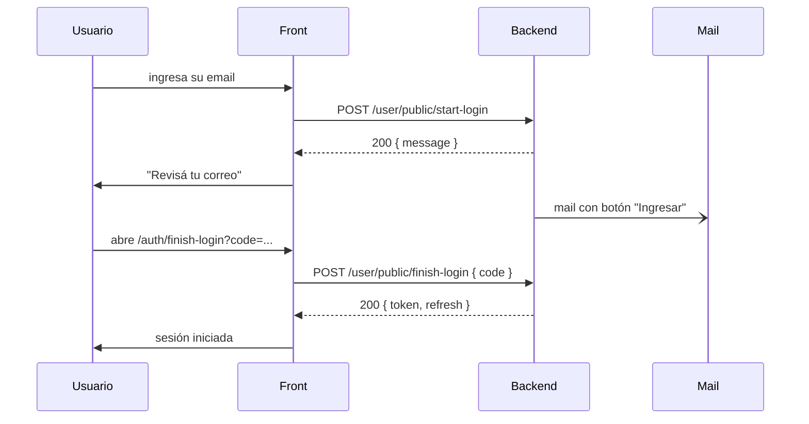

# Guía de integración front — Login sin contraseña (enlace por mail)

Guía para integrar el login sin contraseña: `POST /user/public/start-login` (pide el enlace por mail) y `POST /user/public/finish-login` (canjea el código del enlace por los tokens JWT). Para el detalle de cada endpoint ver [`docs/API.md` §2 — Login sin contraseña](API.md#login-sin-contraseña). Payloads de ejemplo listos para probar: colección `postman/bsports-club.postman_collection.json` → carpeta **"00 · Setup" → "Autenticación"**.

## Qué resuelve

El usuario puede entrar a su cuenta sin escribir la contraseña: ingresa su email, recibe un mail con un botón, y al tocarlo queda logueado. El resultado final es **el mismo que `POST /user/login`**: un `JwtTokenDTO` con `token` y `refresh`, así que todo lo que el front ya hace después del login (guardar tokens, refrescar, leer el usuario) no cambia.

## Flujo completo



## 1. Pantalla "Ingresar con email" — `start-login`

```
POST /user/public/start-login
Content-Type: application/json
```

Sin `Authorization` ni `X-Company-Uuid`.

```json
{
  "email": "socio@mail.com",
  "path": "club-ejemplo"
}
```

| Campo | Tipo | Notas |
|---|---|---|
| `email` | string | Obligatorio, formato email |
| `path` | string | Opcional. El `path` público del club en el que está el usuario (el mismo de `GET /companies/public/by-path/{path}`). Se usa solo para los colores y el logo del mail; si no se manda, el mail sale con la marca de Blue Open Data |

### Respuesta 200 — `StartLoginResponseDTO`

```json
{ "message": "Mail enviado correctamente" }
```

⚠️ **La respuesta es la misma exista o no el email.** El backend no revela qué emails están registrados. El front siempre muestra un mensaje neutro, por ejemplo: *"Si el email está registrado, te enviamos un enlace para ingresar. Revisá tu correo (y la carpeta de spam)."* No mostrar "usuario no encontrado".

El mail se envía en segundo plano, así que la respuesta es inmediata y puede tardar unos segundos en llegar.

### Errores

| Código | `userMessage` | Qué hacer |
|---|---|---|
| 400 | Mapa `campo → mensaje` (Bean Validation) | Email vacío o mal formado. Validarlo también en el cliente |
| 400 | "No está disponible este metodo de login" | El login JWT está deshabilitado en el ambiente. Ocultar la opción |
| 429 | "Ya te enviamos un mail. Por favor, espera 5 minutos para solicitar otro." | Mostrar el mensaje tal cual. Recomendado: deshabilitar el botón "Reenviar" 5 minutos después de cada envío exitoso |

## 2. Pantalla `/auth/finish-login` — `finish-login`

El botón del mail lleva a:

```
{front.url.mail}/auth/finish-login?code={code}
```

El front tiene que tener esa ruta. Al cargarla:

1. Leer `code` del query string. Si no viene, mostrar el error de enlace inválido sin llamar al backend.
2. Llamar **una sola vez** al backend (ojo con frameworks que montan el componente dos veces en desarrollo, o con reintentos automáticos: el código es de un solo uso y el segundo llamado falla).
3. Quitar el `code` de la URL (por ejemplo, `history.replaceState`) para que no quede en el historial.

```
POST /user/public/finish-login
Content-Type: application/json
```

```json
{ "code": "aB3dE5fG7hJ9kL1mN3pQ5rS7tU9vW1xY" }
```

| Campo | Tipo | Notas |
|---|---|---|
| `code` | string | Obligatorio. El valor tal cual viene en el query string |

### Respuesta 200 — `JwtTokenDTO`

```json
{
  "token": "eyJhbGciOi…",
  "refresh": "eyJhbGciOi…"
}
```

Idéntica a `POST /user/login`: guardar los tokens y seguir con el mismo flujo post-login que ya existe (por ejemplo, `GET /user/login` con el token para traer el `UserDTO` y sus `userCompanyRoles`).

### Errores

| Código | `userMessage` | Qué hacer |
|---|---|---|
| 400 | "Código inválido o vencido" | El enlace no existe, ya se usó, venció, fue reemplazado por uno más nuevo o el usuario fue dado de baja. Mostrar *"El enlace no es válido o expiró"* con un botón para volver a pedir uno (paso 1) |
| 400 | Mapa `campo → mensaje` (Bean Validation) | `code` vacío. No debería pasar si el front valida el query string antes |
| 400 | "No está disponible este metodo de login" | Login JWT deshabilitado en el ambiente |

## Reglas que el front tiene que conocer

| Regla | Detalle |
|---|---|
| Vigencia | El enlace vence a los **15 minutos** de pedido. Se puede decir en la pantalla de "Revisá tu correo" |
| Un solo uso | Después de canjearlo, el mismo enlace devuelve 400 |
| Solo vale el último | Pedir un enlace nuevo invalida el anterior. Si el usuario pidió dos, solo funciona el del último mail |
| Espera entre pedidos | Mínimo **5 minutos** entre un pedido y el siguiente para el mismo usuario (429). El enlace ya canjeado no cuenta |
| Usuarios habilitados | Solo usuarios activos. Un usuario con el registro pendiente de verificación no recibe mail (y la respuesta igual es 200) |
| Otro dispositivo | El enlace se puede abrir en cualquier navegador o dispositivo: la sesión queda iniciada donde se abre el enlace, no donde se pidió |

## Checklist

- [ ] Pantalla de email con validación de formato y mensaje neutro tras el 200.
- [ ] Manejo del 429 y bloqueo temporal del botón "Reenviar".
- [ ] Ruta `/auth/finish-login` que lee `code`, llama una sola vez y limpia la URL.
- [ ] Guardado de tokens reutilizando la lógica de `POST /user/login`.
- [ ] Pantalla de enlace inválido o vencido con acceso a pedir uno nuevo.
- [ ] Enviar `path` del club cuando el usuario entra desde la URL de un club, para que el mail salga con su marca.
