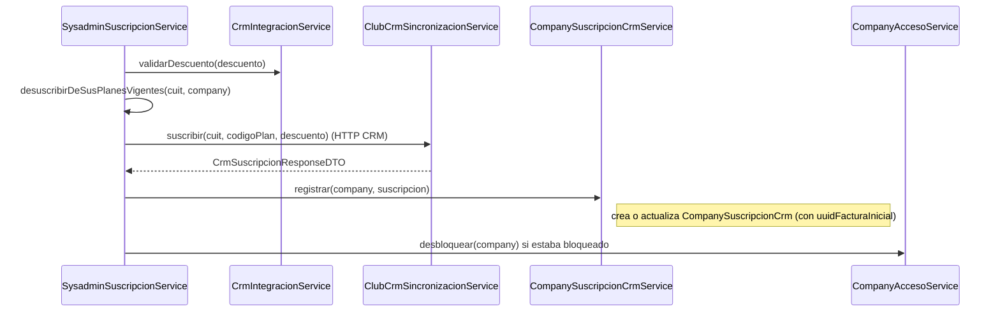
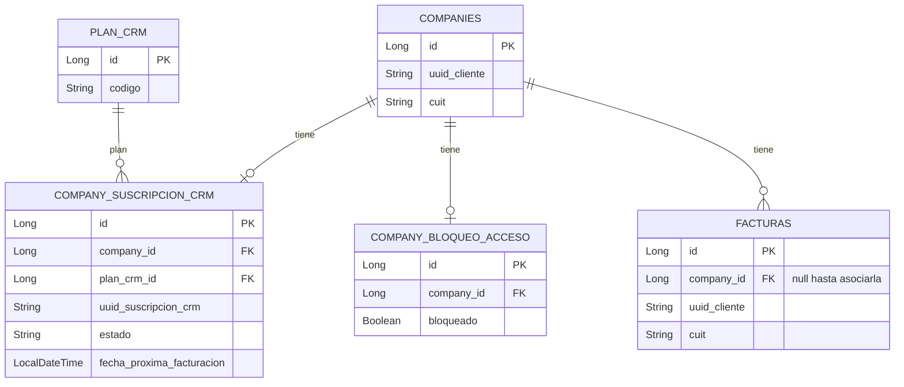

# Alta de club por webhook ALTA_CLIENTE: suscripción y facturas

**Estado:** implementado

## Flujo actual (referencia)

### Alta manual — `POST /sysadmin/clubs` (`SysadminClubService.registerClub`)

```mermaid
sequenceDiagram
    participant C as SysadminClubController
    participant S as SysadminClubService
    participant CR as CompanyRepository
    participant RP as ClubRoleProvisioningService
    participant AD as ClubAdminService
    participant SY as ClubCrmSincronizacionService
    participant CI as CrmIntegracionService
    participant SC as CompanySuscripcionCrmService
    participant AC as CompanyAccesoService
    participant L as ClubRegistradoEventListener
    participant F as FacturaService
    C->>S: registerClub(ClubRegistrationRequestDTO)
    rect rgb(30, 45, 70)
        Note over S,AC: @Transactional (una sola transacción)
        S->>CR: findFirstByCuitAndStatus / findFirstByEmailInstitucionalIgnoreCaseAndStatus
        Note right of S: 400 si ya hay un club activo con ese CUIT o email
        S->>S: saveCompany(request)
        Note right of S: reactiva un club dado de baja o crea uno nuevo, con MercadoPago deshabilitado y BloqueoAcceso desbloqueado
        S->>CR: save(company)
        S->>RP: provisionRoles(company)
        S->>AD: crearAdmin(company, email, nombre, apellido, password)
        S->>SY: registrarCliente(request)
        SY->>CI: crearCliente (HTTP CRM, dentro de la transacción)
        CI-->>SY: CrmClienteResponseDTO (nuevo o CLIENTE_EXISTENTE)
        SY-->>S: uuidCliente
        S->>CR: save(company con uuidCliente)
        S->>CI: obtenerPlanesCliente(cuit) (HTTP CRM)
        CI-->>S: planes del cliente
        alt el CRM no le conoce ningún plan (caso normal)
            S->>AC: bloquear(company)
        else ya tenía un plan (cliente existente)
            S->>SC: registrarDesdeCrm(company, suscripcion)
            Note right of SC: crea o actualiza CompanySuscripcionCrm
            S->>AC: desbloquear / bloquear según estado (ANULADA, PENDIENTE_PAGO + 10 días)
        end
        S->>S: publishEvent(ClubRegistradoEvent)
    end
    S-->>C: ClubRegistrationResponseDTO
    rect rgb(50, 35, 60)
        Note over L,F: @Async, después del commit
        L->>F: asociarFacturasSinClub(companyId, uuidCliente, cuit)
        Note right of F: facturas con company null por uuidCliente o CUIT → asociarCompany
    end
```

Segundo request del alta manual, cuando el club nace sin plan — `POST /sysadmin/clubs/{companyUuid}/crm/suscribir` (`SysadminSuscripcionService.suscribir`):

### Alta por webhook — `ALTA_CLIENTE` (`CrmWebhookProcesador.onAltaCliente`)

```mermaid
sequenceDiagram
    participant W as CrmWebhookProcesador
    participant CS as CompanyService
    participant CR as CompanyRepository
    participant RP as ClubRoleProvisioningService
    participant AD as ClubAdminService
    participant L as ClubRegistradoEventListener
    participant F as FacturaService
    W->>CS: registrarAltaCliente(CrmAltaClienteWebhookDTO)
    rect rgb(30, 45, 70)
        Note over CS,RP: @Transactional
        CS->>CR: existsByUuidClienteOrCuit
        Note right of CS: 409 si ya existe
        CS->>CS: Company.crearDesdeAltaCliente(...)
        Note right of CS: onboardingFinalizado = false, MercadoPago deshabilitado y BloqueoAcceso desbloqueado
        CS->>CR: save(company)
        CS->>RP: provisionRoles(company)
        CS->>CS: publishEvent(ClubRegistradoEvent)
    end
    CS-->>W: company
    rect rgb(30, 45, 70)
        Note over W,AD: @Transactional aparte (si falla, el club queda sin admin)
        W->>AD: crearAdminDeAltaCliente(companyId, correoFacturacion, razonSocial, cuit)
    end
    rect rgb(50, 35, 60)
        Note over L,F: @Async, después del commit
        L->>F: asociarFacturasSinClub(companyId, uuidCliente, cuit)
    end
```

### Diferencias entre los dos flujos

| Paso | Alta manual | Alta por webhook |
|---|---|---|
| Consulta de planes del cliente en el CRM (`obtenerPlanesCliente`) | Sí | No |
| `CompanySuscripcionCrm` | Se crea en el alta si el CRM ya le conoce un plan; si no, en el segundo request `suscribir` | **No se crea nunca** |
| Acceso del club | Bloqueado si no tiene plan; según el estado si lo tiene | Queda **desbloqueado** siempre (`crearDesbloqueada`) |
| Asociación de facturas previas | `ClubRegistradoEvent` → `asociarFacturasSinClub` | `ClubRegistradoEvent` → `asociarFacturasSinClub` (mismo mecanismo) |

## Funcionalidad
**Objetivo:** que el club creado por el webhook `ALTA_CLIENTE` quede con su `CompanySuscripcionCrm` espejada desde el CRM, con el acceso resuelto según esa suscripción y con sus facturas previas asociadas.

**Actores:** CRM (blue-crm, emisor del webhook), `CrmWebhookProcesador`.

**Reglas de negocio:**
- El CRM manda `ALTA_CLIENTE` al pagarse la factura inicial de la suscripción de inscripción, así que para ese momento el cliente ya tiene un plan del lado del CRM.
- El flujo del webhook queda en este orden, orquestado completo por `CompanyService.registrarAltaCliente`. `CrmWebhookProcesador.onAltaCliente` solo llama a ese método:
  1. Alta del club, en su propia transacción. Ya no publica `ClubRegistradoEvent` en ese paso.
  2. Alta del admin (`crearAdminDeAltaCliente`), en su propia transacción, igual que hoy: si falla se loguea y se sigue.
  3. Consulta de la suscripción del cliente en el CRM (`obtenerPlanesCliente(cuit)`), fuera de transacción. Se toma la primera, igual que el alta manual.
  4. Registro de la suscripción en `CompanySuscripcionCrm` (`registrarDesdeCrm`) y resolución del acceso con la misma regla del alta manual: bloqueado si está `ANULADA` o `PENDIENTE_PAGO` con más de 10 días; desbloqueado en cualquier otro estado.
  5. Publicación de `ClubRegistradoEvent`, que después del commit asocia al club las facturas que llegaron antes que el alta (`asociarFacturasSinClub`).
- Si falla cualquier paso del 3 al 5 (el CRM no responde, no informa ninguna suscripción, o el plan no está sincronizado en `plan_crm`): el alta del club no se revierte; se loguea el error y no se ejecutan los pasos siguientes. El evento se confirma igual al CRM (no se lanza), para que el reintento no choque con el 409 de club existente.
- La regla de suscripción y acceso es una sola para el alta manual y el webhook: no se duplica.

**Casos borde:**
- Falla la sincronización de la suscripción: el club queda creado, sin `CompanySuscripcionCrm`, con el acceso desbloqueado con que nace, y sin las facturas previas asociadas. Las `DEUDA_GENERADA` que lleguen después sí se asocian, porque `registrarDeudaGenerada` busca el club por `uuidCliente`.
- Falla el alta del admin: no corta los pasos 3 a 5.
- El alta del club falla (409 club existente, datos faltantes): no se ejecuta ningún paso siguiente, igual que hoy.

**Fuera de alcance:**
- Cambios de comportamiento en el alta manual (`SysadminClubService.registerClub`); solo se mueve la regla de suscripción y acceso a donde la puedan usar los dos flujos.
- Guardar `uuidFacturaInicialCrm` en el alta por webhook.
- Backfill de los clubes ya creados por webhook sin suscripción.
- Reintentar la sincronización de la suscripción si falla.

## Modelo de datos

| Entidad | Cambio |
|---|---|
| COMPANY_SUSCRIPCION_CRM | existente, sin cambios; ahora también la crea el alta por webhook |
| COMPANY_BLOQUEO_ACCESO | existente, sin cambios |
| FACTURAS | existente, sin cambios |
| COMPANIES / PLAN_CRM | existentes, sin cambios |

## Diseño

```mermaid
classDiagram
    class ClubSuscripcionInicialService {
        <<nuevo>>
        +buscarSuscripcionEnCrm(String cuit) CrmSuscripcionActivaDTO
        +aplicarSuscripcion(Company company, CrmSuscripcionActivaDTO suscripcion) void
        -habilitaAcceso(CrmSuscripcionActivaDTO suscripcion) boolean
        -vencioLaGraciaDePago(LocalDateTime fechaInicio) boolean
    }
    class SysadminClubService {
        <<modificado>>
        -sincronizarSuscripcionDelCrm(Company company) void
    }
    class CompanyService {
        <<modificado>>
        +registrarAltaCliente(CrmAltaClienteWebhookDTO data) Company
        -crearClubDeAltaCliente(CrmAltaClienteWebhookDTO data) Company
        -crearAdminDeAltaCliente(Company company, CrmAltaClienteWebhookDTO data) void
        -sincronizarSuscripcionDeAltaCliente(Company company) void
        -completarAltaCliente(Long companyId, CrmSuscripcionActivaDTO suscripcion) void
    }
    class CrmWebhookProcesador {
        <<modificado>>
        #onAltaCliente(CrmAltaClienteWebhookDTO data, String eventId) void
    }
    class TransactionTemplate {
        +execute(TransactionCallback action) T
        +executeWithoutResult(Consumer action) void
    }
    class CompanySuscripcionCrmService {
        +registrarDesdeCrm(Company company, CrmSuscripcionActivaDTO suscripcion) void
    }
    class CompanyAccesoService {
        +bloquear(Company company) void
        +desbloquear(Company company) void
    }
    class CrmIntegracionService {
        +obtenerPlanesCliente(String cuit) CrmPlanesClienteResponseDTO
    }
    class ClubAdminService {
        +crearAdminDeAltaCliente(Long companyId, String email, String nombre, String cuit) void
    }
    class ClubRegistradoEvent
    class ClubRegistradoEventListener {
        +onClubRegistrado(ClubRegistradoEvent event) void
    }
    class FacturaService {
        +asociarFacturasSinClub(Long companyId, String uuidCliente, String cuit) void
    }
    SysadminClubService ..> ClubSuscripcionInicialService
    SysadminClubService ..> CompanyAccesoService
    CompanyService ..> ClubSuscripcionInicialService
    CompanyService ..> ClubRegistradoEvent
    CompanyService ..> TransactionTemplate
    CompanyService ..> ClubAdminService
    CrmWebhookProcesador ..> CompanyService
    ClubSuscripcionInicialService ..> CrmIntegracionService
    ClubSuscripcionInicialService ..> CompanySuscripcionCrmService
    ClubSuscripcionInicialService ..> CompanyAccesoService
    ClubRegistradoEventListener ..> ClubRegistradoEvent
    ClubRegistradoEventListener ..> FacturaService
```

| Clase | Método | Cambio |
|---|---|---|
| ClubSuscripcionInicialService | — | nuevo `@Service` en `Code/Service`: la regla de suscripción y acceso del alta, compartida por el alta manual y el webhook |
| ClubSuscripcionInicialService | buscarSuscripcionEnCrm | movido desde `SysadminClubService.buscarSuscripcionEnCrm`, ahora recibe el CUIT: normaliza el CUIT, llama a `obtenerPlanesCliente` y devuelve la primera suscripción, o null. Sin transacción (HTTP) |
| ClubSuscripcionInicialService | aplicarSuscripcion | nuevo `@Transactional`, con el cuerpo que hoy está en `sincronizarSuscripcionDelCrm` para el caso con suscripción: `registrarDesdeCrm` + `desbloquear` si `habilitaAcceso`, `bloquear` si no |
| ClubSuscripcionInicialService | habilitaAcceso / vencioLaGraciaDePago | movidos sin cambios desde `SysadminClubService`, con la constante `DIAS_GRACIA_PENDIENTE_PAGO = 10` |
| SysadminClubService | sincronizarSuscripcionDelCrm | modificado: `buscarSuscripcionEnCrm(company.getCuit())`; null → `bloquear`; si no, `aplicarSuscripcion`. Mismo comportamiento que hoy |
| SysadminClubService | buscarSuscripcionEnCrm / habilitaAcceso / vencioLaGraciaDePago / normalizarCuit / `DIAS_GRACIA_PENDIENTE_PAGO` | se eliminan (pasan a `ClubSuscripcionInicialService`) |
| CompanyService | registrarAltaCliente | modificado: pasa a orquestar sin transacción propia (`@Transactional(propagation = NOT_SUPPORTED)`, porque `BaseCompanyService` es transaccional a nivel de clase). Crea el club con `transactionTemplate.execute(crearClubDeAltaCliente)`, que commitea, después llama a `crearAdminDeAltaCliente` y a `sincronizarSuscripcionDeAltaCliente`. Devuelve el club. Sigue lanzando si el alta del club falla (409, datos faltantes) |
| CompanyService | crearClubDeAltaCliente | nuevo privado: el cuerpo actual de `registrarAltaCliente` (validación, `crearDesdeAltaCliente`, path, save, roles), sin publicar el evento |
| CompanyService | crearAdminDeAltaCliente | nuevo privado: el `try/catch` que hoy está en `CrmWebhookProcesador.onAltaCliente`. Llama a `ClubAdminService.crearAdminDeAltaCliente` (transacción propia); si falla, `log.error` y sigue |
| CompanyService | sincronizarSuscripcionDeAltaCliente | nuevo privado: `buscarSuscripcionEnCrm(company.getCuit())` fuera de transacción; null → `log.warn` y corta; si no, `transactionTemplate.executeWithoutResult(completarAltaCliente)`. Cualquier excepción → `log.error` y corta, sin propagar |
| CompanyService | completarAltaCliente | nuevo privado, corre dentro del `transactionTemplate`: carga el club por id, `aplicarSuscripcion` y publica `ClubRegistradoEvent`. El evento se publica dentro de esa transacción para que el listener `AFTER_COMMIT` se dispare |
| CrmWebhookProcesador | onAltaCliente | modificado: solo llama a `registrarAltaCliente`. Se quita la creación del admin y la dependencia `ClubAdminService` |

**Alta por webhook — `ALTA_CLIENTE`**

```mermaid
sequenceDiagram
    participant W as CrmWebhookProcesador
    participant CS as CompanyService
    participant T as TransactionTemplate
    participant SI as ClubSuscripcionInicialService
    participant CI as CrmIntegracionService
    participant SC as CompanySuscripcionCrmService
    participant AC as CompanyAccesoService
    participant AD as ClubAdminService
    participant L as ClubRegistradoEventListener
    participant F as FacturaService
    W->>CS: registrarAltaCliente(data)
    Note over CS: sin transacción propia (NOT_SUPPORTED)
    CS->>T: execute(crearClubDeAltaCliente)
    rect rgb(30, 45, 70)
        Note over CS,T: transacción 1, commitea el club
        T->>CS: crearClubDeAltaCliente(data)
        CS->>CS: validar, crear club, path, save, roles
    end
    CS->>CS: crearAdminDeAltaCliente(company, data)
    rect rgb(30, 45, 70)
        Note over CS,AD: transacción del admin, si falla se loguea y se sigue
        CS->>AD: crearAdminDeAltaCliente(companyId, correoFacturacion, razonSocial, cuit)
    end
    CS->>CS: sincronizarSuscripcionDeAltaCliente(company)
    CS->>SI: buscarSuscripcionEnCrm(cuit)
    SI->>CI: obtenerPlanesCliente(cuit) (HTTP, sin transacción)
    CI-->>SI: planes
    SI-->>CS: suscripcion (null → log.warn y fin)
    CS->>T: executeWithoutResult(completarAltaCliente)
    rect rgb(30, 45, 70)
        Note over CS,AC: transacción 2
        T->>CS: completarAltaCliente(companyId, suscripcion)
        CS->>CS: findById(companyId)
        CS->>SI: aplicarSuscripcion(company, suscripcion)
        SI->>SC: registrarDesdeCrm(company, suscripcion)
        SI->>AC: desbloquear o bloquear según habilitaAcceso
        CS->>CS: publishEvent(ClubRegistradoEvent)
    end
    Note over CS: cualquier excepción desde buscarSuscripcionEnCrm → log.error y fin, el club queda creado
    CS-->>W: company
    rect rgb(50, 35, 60)
        Note over L,F: @Async, después del commit de la transacción 2
        L->>F: asociarFacturasSinClub(companyId, uuidCliente, cuit)
    end
```

**Alta manual — `sincronizarSuscripcionDelCrm` (mismo comportamiento, regla movida)**

```mermaid
sequenceDiagram
    participant S as SysadminClubService
    participant SI as ClubSuscripcionInicialService
    participant AC as CompanyAccesoService
    rect rgb(30, 45, 70)
        Note over S,AC: @Transactional de registerClub
        S->>SI: buscarSuscripcionEnCrm(company.getCuit())
        SI-->>S: suscripcion
        alt sin suscripción
            S->>AC: bloquear(company)
        else con suscripción
            S->>SI: aplicarSuscripcion(company, suscripcion)
        end
        S->>S: publishEvent(ClubRegistradoEvent) (sin cambios)
    end
```

## Decisiones
- Registro de la suscripción: `registrarDesdeCrm` con lo que devuelve `obtenerPlanesCliente` — el cliente ya viene suscripto, no hay respuesta de `POST suscribir` para usar `registrar`.
- Asociación de facturas: se reutiliza `ClubRegistradoEvent` → `asociarFacturasSinClub`, que asocia todas las facturas previas sin club, sin filtrar por estado.
- Falla de la sincronización: no revierte el alta ni bloquea el acceso; se loguea y se corta — pedido explícito.
- Backfill: no se hace — pedido explícito.
- Orquestación del alta por webhook: todo en `CompanyService.registrarAltaCliente` (club, admin, suscripción y facturas); `CrmWebhookProcesador` solo lo invoca — pedido explícito. Las dos transacciones se manejan con `TransactionTemplate` (patrón ya usado en Tesorería), porque una llamada a un método `@Transactional` de la misma clase no pasa por el proxy.
