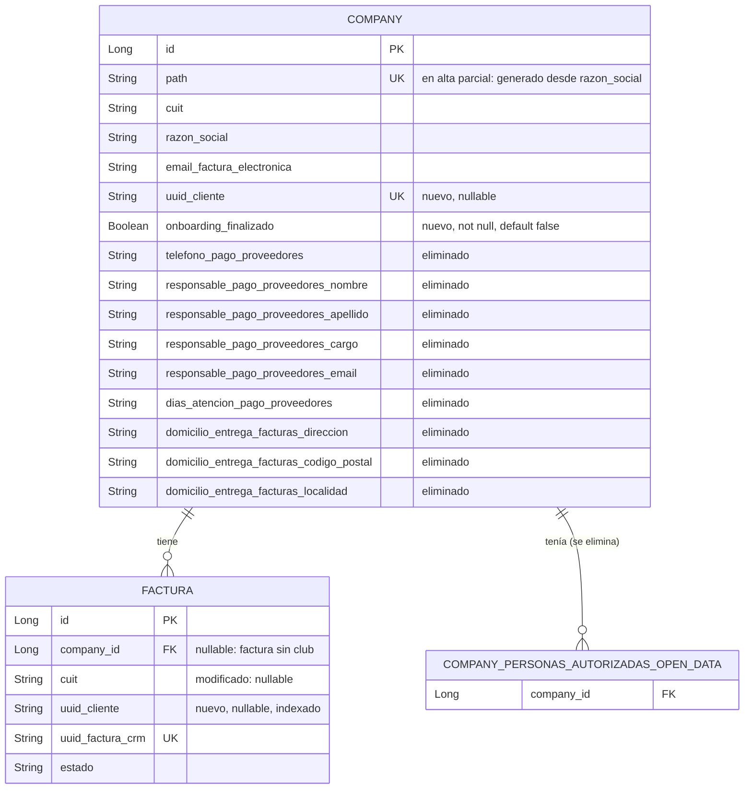

# Alta parcial de Company (onboarding desde ALTA_CLIENTE del CRM)

**Estado:** implementado

## Funcionalidad
**Objetivo:** dar de alta una `Company` de forma parcial cuando el CRM avisa que un cliente se dio de alta (`ALTA_CLIENTE`), registrando su `uuidCliente` y los datos del webhook, con el onboarding pendiente (`onboardingFinalizado = false`). Adaptar `DEUDA_GENERADA` y `PAGO_IMPUTADO` para identificar al club por `uuidCliente` (con `cuit` como fallback). En el mismo cambio se eliminan de `Company` los campos de pago a proveedores, personas autorizadas y domicilio de entrega de facturas.

**Actores:**
- CRM (blue-crm): envía `ALTA_CLIENTE`, `DEUDA_GENERADA` y `PAGO_IMPUTADO` a `POST /webhookCrm`.

**Reglas de negocio:**

*Company*
- `Company` incorpora:
  - `uuidCliente`: identificador del cliente en el CRM. Único, nullable (las Companies existentes pueden no tenerlo).
  - `onboardingFinalizado`: boolean, no nulo, por defecto `false`. Las Companies existentes se migran con `true`.
- Se eliminan de `Company` y de la base:
  - `personasAutorizadasOpenData` (tabla `company_personas_autorizadas_open_data`)
  - `telefonoPagoProveedores`
  - `responsablePagoProveedoresNombre`, `responsablePagoProveedoresApellido`, `responsablePagoProveedoresCargo`, `responsablePagoProveedoresEmail`
  - `diasAtencionPagoProveedores`
  - `domicilioEntregaFacturas` (columnas `domicilio_entrega_facturas_*`)
- Toda referencia a esos campos en DTOs (incluidos `CompanyDTO` y `ClubProfileUpdateRequestDTO`), mappers y services se elimina.

*Alta parcial*
- Mapeo del payload `ALTA_CLIENTE` → `Company`:

  | Campo webhook | Campo Company |
  |---|---|
  | `uuidCliente` | `uuidCliente` (nuevo) |
  | `razonSocial` | `razonSocial` |
  | `cuit` | `cuit` |
  | `correoFacturacion` | `emailFacturaElectronica` |
  | `codigoCondicionImpositiva` | no se persiste |
  | `estadoRegistro` | no se persiste |

- El `cuit` llega normalizado desde el CRM (11 dígitos, sin guiones); se guarda y se compara tal cual.
- La Company parcial se crea con status `ACTIVE` y `onboardingFinalizado = false`. El resto de los datos del club se completan en el onboarding posterior.
- El `path` se genera desde la `razonSocial`: sin tildes ni diacríticos, en minúsculas, los `.` se eliminan, cualquier tramo de caracteres no alfanuméricos se reemplaza por `-`, y se quitan los `-` de los extremos. Ej.: `Club Atlético Norte S.A.` → `club-atletico-norte-sa`. Si no queda ningún carácter, se usa el `cuit`.
- Si el `path` ya existe (en cualquier Company, sin filtrar status), se le agrega un sufijo numérico: `-2`, `-3`, … hasta encontrar uno libre.
- El alta siempre crea una Company nueva. Antes de crearla se verifica en base si ya existe una Company con ese `uuidCliente` o con ese `cuit`; si existe, se lanza excepción, que se traduce en ACK con error.
- Obligatorios en el payload: `uuidCliente`, `razonSocial`, `cuit` y `correoFacturacion`; si falta alguno se lanza excepción.
- Al crear la Company, se asocian las facturas que hayan quedado sin club por haber llegado antes que el alta: por `uuidCliente` y, como fallback, por `cuit`.

*Usuario administrador del alta parcial*
- `ALTA_CLIENTE` crea también el usuario administrador del club, con el rol `ADMIN` de esa Company.
- Datos del usuario: `email` y `username` = `correoFacturacion`; contraseña = `cuit` (encriptada con el `PasswordEncoder`); `nombre` = `razonSocial`.
- En la transacción de la Company se provisionan los roles del club y se crean sus filas por defecto de Mercado Pago (deshabilitado) y de bloqueo de acceso (desbloqueada), igual que en el alta por sysadmin.
- El admin se crea **después** de confirmada la Company, en una transacción aparte. Si falla (por ejemplo, el email ya pertenece a un usuario), la Company queda creada, se loguea el error, `adminCreado` queda en `false` y el ACK sale ok.
- Si el admin se crea, la Company pasa a `adminCreado = true`.
- La creación del usuario se comparte con el alta por sysadmin: un único servicio crea el `User` y su `UserCompanyRole`; `SysadminClubService` pasa a usarlo.

*Webhook*
- Nuevo tipo `ALTA_CLIENTE` en `CrmTipoEventoEnum`, con su método sobrescribible `onAltaCliente` en `AbstractCrmWebhookProcesador` e implementación en `CrmWebhookProcesador`. Hereda la idempotencia por `eventId` y el ACK automático del procesador existente; ACK sin `data` adicional.

*Asociación de facturas por `uuidCliente`*
- Los payloads de `DEUDA_GENERADA` y `PAGO_IMPUTADO` incorporan `uuidCliente`; se conserva `cuit` para eventos emitidos antes del cambio.
- `Factura` guarda `uuidCliente` además de `cuit`; las facturas sin club se crean con ambos. Como el CRM deja de mandar `cuit` en `DEUDA_GENERADA`, `facturas.cuit` pasa a ser nullable: la factura exige al menos uno de los dos. Si el club se encuentra, el `cuit` de la factura se toma del club cuando el webhook no lo trae.
- Búsqueda del club: primero por `uuidCliente`; si no viene o no hay Company con ese uuid, por `cuit`.

*Esquema*
- Los cambios de esquema (columnas nuevas en `companies` y `facturas`, migración de `onboarding_finalizado = true` para existentes, drop de columnas y de `company_personas_autorizadas_open_data`) van en un changeset Liquibase `v66`.

**Casos borde:**
- Reenvío del mismo `ALTA_CLIENTE` (mismo `eventId`): lo corta la idempotencia del procesador.
- `ALTA_CLIENTE` de un club que ya existe (por `uuidCliente` o `cuit`), por ejemplo un club previo al cambio: excepción → ACK con error.
- `DEUDA_GENERADA` / `PAGO_IMPUTADO` antes que `ALTA_CLIENTE`: la deuda se registra sin club y se asocia al darse el alta. El pago marca la factura como pagada aunque no exista el club; solo se omiten el movimiento de tesorería y el desbloqueo (comportamiento actual). El pago lanza únicamente si la factura no existe.
- `ALTA_CLIENTE` sin alguno de los campos obligatorios: excepción → ACK con error.
- `ALTA_CLIENTE` cuyo `correoFacturacion` ya pertenece a un usuario: la Company se crea igual, sin admin (`adminCreado = false`), y el ACK sale ok.

**Fuera de alcance:**
- Endpoint en `CompanyController` para registrar el alta parcial a mano.
- Finalizar el onboarding (pasar `onboardingFinalizado` a `true`) y el flujo de completar datos del club.
- Generación automática del `path`.

## Modelo de datos

| Entidad | Cambio |
|---|---|
| COMPANY | modificada: + `uuid_cliente` (único), + `onboarding_finalizado`; − campos de pago a proveedores y domicilio de entrega de facturas |
| FACTURA | modificada: + `uuid_cliente` (índice no único), `cuit` pasa a nullable |
| COMPANY_PERSONAS_AUTORIZADAS_OPEN_DATA | eliminada (drop table) |

**Changeset Liquibase `v66`:**
1. `companies`: add `uuid_cliente varchar(64) null` + índice único; add `onboarding_finalizado boolean not null default false`.
2. `update companies set onboarding_finalizado = true` (todas las existentes).
3. `facturas`: add `uuid_cliente varchar(64) null` + índice `(uuid_cliente)`; `modify cuit varchar(20) null`.
4. Drop de las columnas eliminadas de `companies` y `drop table company_personas_autorizadas_open_data`.

## Diseño

```mermaid
classDiagram
    class CrmTipoEventoEnum {
        <<modificado>>
        ALTA_CLIENTE
    }
    class CrmAltaClienteWebhookDTO {
        <<nuevo>>
        -String uuidCliente
        -String razonSocial
        -String cuit
        -String correoFacturacion
    }
    class CrmDeudaGeneradaWebhookDTO {
        <<modificado>>
        -String uuidCliente
    }
    class CrmPagoImputadoWebhookDTO {
        <<modificado>>
        -String uuidCliente
    }
    class AbstractCrmWebhookProcesador {
        <<modificado>>
        #onAltaCliente(CrmAltaClienteWebhookDTO data, String eventId) void
        -ejecutarEvento(CrmWebhookEventoDTO evento) CrmWebhookAckDataDTO
    }
    class CrmWebhookProcesador {
        <<modificado>>
        #onAltaCliente(CrmAltaClienteWebhookDTO data, String eventId) void
    }
    class CompanyService {
        <<modificado>>
        +registrarAltaCliente(CrmAltaClienteWebhookDTO data) Company
        -validarClienteNoRegistrado(String uuidCliente, String cuit) void
        -resolverPathDisponible(String pathBase) String
    }
    class ClubAdminService {
        <<nuevo>>
        +crearAdminDeAltaCliente(Long companyId, String email, String nombre, String cuit) void
        +crearAdmin(Company company, String email, String nombre, String apellido, String password) User
        -validarEmailDisponible(String email) void
    }
    class ClubRoleProvisioningService {
        +provisionRoles(Company company) void
        +getAdminRole(Company company) Role
    }
    class SysadminClubService {
        <<modificado>>
        +registerClub(ClubRegistrationRequestDTO request) ClubRegistrationResponseDTO
    }
    class Company {
        <<modificado>>
        -String uuidCliente
        -Boolean onboardingFinalizado
        +crearDesdeAltaCliente(String uuidCliente, String razonSocial, String cuit, String emailFacturaElectronica)$ Company
        +marcarAdminCreado() void
        -generarPath(String razonSocial, String cuit)$ String
    }
    class CompanyRepository {
        <<modificado>>
        +existsByUuidClienteOrCuit(String uuidCliente, String cuit) boolean
        +existsByPath(String path) boolean
        +findFirstByUuidCliente(String uuidCliente) Company
        +findFirstByUuidClienteAndStatus(String uuidCliente, Integer status) Company
    }
    class ClubRegistradoEvent {
        <<modificado>>
        -String uuidCliente
        +ClubRegistradoEvent(Long companyId, String uuidCliente, String cuit)
    }
    class ClubRegistradoEventListener {
        <<modificado>>
        +onClubRegistrado(ClubRegistradoEvent event) void
    }
    class FacturaService {
        <<modificado>>
        +registrarDeudaGenerada(CrmDeudaGeneradaWebhookDTO data) void
        +registrarPagoImputado(CrmPagoImputadoWebhookDTO data) void
        +asociarFacturasSinClub(Long companyId, String uuidCliente, String cuit) void
        -buscarCompanyActiva(String uuidCliente, String cuit) Company
        -buscarCompany(String uuidCliente, String cuit) Company
    }
    class Factura {
        <<modificado>>
        -String uuidCliente
        +crear(Company company, String uuidCliente, String cuit, String uuidFacturaCrm, List~String~ codigosPlanes, List~String~ codigosProductos, BigDecimal importe)$ Factura
    }
    class FacturaRepository {
        <<modificado>>
        +buscarSinClubPorClienteOCuit(String uuidCliente, String cuit, int status) List~Factura~
    }
    CrmWebhookProcesador --|> AbstractCrmWebhookProcesador
    CrmWebhookProcesador ..> CompanyService
    CrmWebhookProcesador ..> FacturaService
    CompanyService ..> CompanyRepository
    CompanyService ..> Company
    CompanyService ..> ClubRegistradoEvent : publica
    CompanyService ..> ClubRoleProvisioningService
    CrmWebhookProcesador ..> ClubAdminService
    ClubAdminService ..> ClubRoleProvisioningService
    SysadminClubService ..> ClubAdminService
    ClubRegistradoEventListener ..> FacturaService
    FacturaService ..> CompanyRepository
    FacturaService ..> FacturaRepository
    FacturaService ..> Factura
```

| Clase | Método / campo | Cambio |
|---|---|---|
| CrmTipoEventoEnum | `ALTA_CLIENTE` | nuevo valor |
| CrmAltaClienteWebhookDTO | — | nuevo; `@JsonIgnoreProperties(ignoreUnknown = true)`, ignora `codigoCondicionImpositiva` y `estadoRegistro` |
| CrmDeudaGeneradaWebhookDTO / CrmPagoImputadoWebhookDTO | `uuidCliente` | nuevo campo; `cuit` se conserva |
| AbstractCrmWebhookProcesador | `onAltaCliente` | nuevo: default loguea y lanza, como el resto |
| AbstractCrmWebhookProcesador | `ejecutarEvento` | modificado: rama `ALTA_CLIENTE` → `onAltaCliente` + `CrmWebhookAckDataDTO.confirmar(eventId)` |
| CrmWebhookProcesador | `onAltaCliente` | nuevo: llama a `CompanyService.registrarAltaCliente` y, ya confirmada la Company, a `ClubAdminService.crearAdminDeAltaCliente` dentro de un try/catch que solo loguea |
| CompanyService | `registrarAltaCliente` | nuevo, `@Transactional`: valida, crea la Company con sus defaults, la guarda, provisiona roles y publica `ClubRegistradoEvent` |
| ClubAdminService | `crearAdminDeAltaCliente` | nuevo, `@Transactional` aparte: carga la Company, obtiene su rol `ADMIN`, llama a `crearAdmin` (contraseña = `cuit`) y marca `adminCreado` |
| ClubAdminService | `crearAdmin` | nuevo: valida que el email no exista, crea el `User` (username = email, contraseña encriptada) y su `UserCompanyRole` con el rol `ADMIN`. Es el cuerpo actual de `SysadminClubService.saveAdminUser`, movido |
| SysadminClubService | `saveAdminUser` | eliminado: `registerClub` llama a `ClubAdminService.crearAdmin` con los datos de `ClubAdminRequestDTO` |
| Company | `marcarAdminCreado` | nuevo: `adminCreado = true` |
| Company | `generarPath` | nuevo: arma el `path` base desde la razón social (el factory lo asigna) |
| CompanyService | `resolverPathDisponible` | nuevo: si el `path` base existe, prueba `-2`, `-3`, … con `existsByPath` |
| Company | `crearDesdeAltaCliente` | modificado: crea también `CompanyMercadoPago.crearDeshabilitadoVacias` y `CompanyBloqueoAcceso.crearDesbloqueada` |
| CompanyService | `validarClienteNoRegistrado` | nuevo: lanza si `existsByUuidClienteOrCuit` (sin filtrar status) |
| Company | `crearDesdeAltaCliente` | nuevo factory: valida obligatorios, status `ACTIVE`, `onboardingFinalizado = false`, `path` null |
| Company | campos eliminados | − `personasAutorizadasOpenData`, `telefonoPagoProveedores`, `responsablePagoProveedores*`, `diasAtencionPagoProveedores`, `domicilioEntregaFacturas` |
| CompanyPersonaAutorizadaOpenData | — | eliminada |
| CompanyDTO, ClubProfileFieldsDTO (y por herencia ClubProfileUpdateRequestDTO y ClubRegistrationRequestDTO), CompanyMapper | — | modificados: se quitan los campos eliminados |
| CompanyPersonaAutorizadaOpenDataDTO | — | eliminada |
| CompanyRepository | `findByIdInWithPersonas` | eliminado; `CompanyService.paginar` mapea directo |
| ClubCrmSincronizacionService | `armarContacto`, `normalizarTelefono` | eliminados: el alta de cliente en el CRM se envía sin `contactoPrincipal` |
| ClubRegistradoEvent | constructor | modificado: + `uuidCliente` |
| SysadminClubService | `registerClub` / `guardarUuidCliente` | modificado: guarda en la Company el `uuidCliente` que devuelve el alta de cliente del CRM (creado o existente) y lo pasa al evento |
| ClubRegistradoEventListener | `onClubRegistrado` | modificado: pasa `uuidCliente` a `asociarFacturasSinClub` |
| FacturaService | `registrarDeudaGenerada` | modificado: club por `buscarCompanyActiva`; `cuit` = webhook o, si no viene, el del club |
| FacturaService | `registrarPagoImputado` | modificado: club por `buscarCompany` |
| FacturaService | `asociarFacturasSinClub` | modificado: + `uuidCliente`; usa `buscarSinClubPorClienteOCuit` |
| FacturaService | `buscarCompanyActiva` / `buscarCompany` | nuevos: `uuidCliente` primero, `cuit` como fallback (con / sin filtro de status) |
| Factura | `crear` | modificado: + `uuidCliente`; lanza si faltan `uuidCliente` y `cuit` a la vez |
| FacturaRepository | `buscarSinClubPorClienteOCuit` | nuevo: `company is null and status = :status and (uuidCliente = :uuidCliente or cuit = :cuit)` |

```mermaid
sequenceDiagram
    participant W as CrmWebhookController
    participant P as CrmWebhookProcesador
    participant CS as CompanyService
    participant CR as CompanyRepository
    participant RP as ClubRoleProvisioningService
    participant AS as ClubAdminService
    participant L as ClubRegistradoEventListener
    participant FS as FacturaService
    participant FR as FacturaRepository
    participant CRM as CRM (blue-crm)
    W->>P: procesarAsync(body)
    W-->>CRM: 200
    Note over P: idempotencia por eventId (existente)
    P->>CS: onAltaCliente → registrarAltaCliente(data)
    rect rgb(30, 45, 70)
        Note over CS,CR: @Transactional
        CS->>CR: existsByUuidClienteOrCuit(uuidCliente, cuit)
        CR-->>CS: false (si true → throw)
        CS->>CS: Company.crearDesdeAltaCliente(...) + path base + defaults MP y bloqueo
        CS->>CR: existsByPath(path), existsByPath(path-2)…
        CS->>CS: company.setPath(pathDisponible)
        CS->>CR: save(company)
        CS->>RP: provisionRoles(company)
        CS->>CS: publishEvent(ClubRegistradoEvent)
    end
    CS-->>P: Company
    rect rgb(45, 35, 60)
        Note over P,AS: try / catch → solo log. @Transactional propia
        P->>AS: crearAdminDeAltaCliente(companyId, correoFacturacion, razonSocial, cuit)
        AS->>RP: getAdminRole(company)
        AS->>AS: crearAdmin(...) (email existente → throw, atrapado)
        AS->>AS: company.marcarAdminCreado()
    end
    P->>CRM: ACK ok (ACK error solo si falló la Company)
    Note over L: AFTER_COMMIT, @Async
    L->>FS: asociarFacturasSinClub(companyId, uuidCliente, cuit)
    rect rgb(30, 45, 70)
        Note over FS,FR: @Transactional
        FS->>FR: buscarSinClubPorClienteOCuit(uuidCliente, cuit, ACTIVE)
        FR-->>FS: List~Factura~
        FS->>FR: saveAll(asociadas)
    end
```

## Decisiones
- Alta parcial: solo por webhook `ALTA_CLIENTE` — el endpoint queda fuera de alcance.
- Club existente (por `uuidCliente` o `cuit`) en `ALTA_CLIENTE`: excepción → ACK con error — por ahora no se vinculan clubes previos.
- Búsqueda del club en facturas: `uuidCliente` con `cuit` como fallback — compatibilidad con eventos previos al cambio del CRM.
- `path` de la Company parcial: generado desde la razón social, en minúsculas y sin `.`; sufijo numérico si ya existe — así el club tiene URL desde el alta sin pisar otro path.
- Companies existentes: `onboarding_finalizado = true`.
- Condición impositiva: no se persiste — no se usa en el club.
- CUIT: se confía en que el CRM lo manda normalizado — sin normalización ni migración de `companies.cuit`.
- Clubes existentes sin `uuid_cliente`: siguen resolviéndose por `cuit` — sin carga inicial de uuids.
- Alta manual (sysadmin): guarda el `uuidCliente` que responde `POST /integraciones/cliente/crear` — así sus webhooks se resuelven por uuid desde el primer momento.
- Admin del alta parcial: se crea después de la Company y su falla no la revierte — la Company no depende del usuario; queda `adminCreado = false` para detectarla.
- Campos eliminados: se borran también de todos los DTOs, incluido el alta por sysadmin — la sincronización con el CRM deja de enviar el contacto principal (responsable de pago a proveedores).
