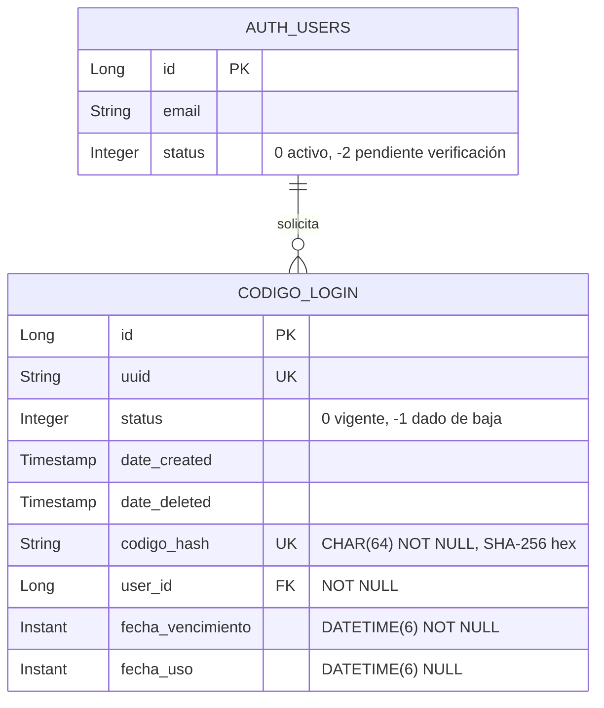

# Login sin contraseña

**Estado:** implementado

## Funcionalidad
**Objetivo:** permitir que un usuario inicie sesión sin contraseña, recibiendo por mail un enlace con un código de un solo uso que el front canjea por los tokens JWT.

**Actores:** usuario (cualquier tipo de `User` registrado), front, servicio de mail.

**Endpoints** (en `UserController`, públicos):
- `POST user/public/start-login` — request `StartLoginRequestDTO { email, path? }`, response `StartLoginResponseDTO { message }`.
- `POST user/public/finish-login` — request `FinishLoginRequestDTO { code }`, response `JwtTokenDTO` (el mismo body que `POST user/login`).

**Reglas de negocio:**
- Todo el código nuevo vive fuera de `Core` (paquete `Code`). No se modifica ninguna clase de `Core` ni se usa `SecurityCode`.
- Los códigos de login se guardan en una tabla propia, `codigo_login`.
- `start-login` busca el usuario activo por email (`status = 0`). Si no existe, responde 200 igual y no envía nada (no revela si el email está registrado), como `forgot-password`.
- Los usuarios pendientes de verificación (`status = -2`) no pueden usar este flujo: al buscar solo `status = 0` quedan tratados como inexistentes.
- `start-login` no requiere captcha.
- Si existe, genera un código alfanumérico aleatorio de 32 caracteres (`SecureRandom`), crea un `CodigoLogin` con el hash SHA-256 del código, vencimiento a los 15 minutos, asociado al usuario, y publica un evento con el código en claro. El código en claro no se persiste.
- El mail se envía de forma asíncrona, después del commit (`@Async` + `@TransactionalEventListener(AFTER_COMMIT)`, como los listeners existentes en `Code/Event`). Si el envío falla se loguea; el endpoint ya respondió 200.
- El mail usa una plantilla nueva con el mismo estilo que `recuperar-password.html` (colores e imagen del club según `path`, con fallback a la company "2" como forgot-password) y un botón que lleva a `{front.url.mail}/auth/finish-login?code={code}`.
- Cooldown de 5 minutos entre pedidos para el mismo usuario: si hay un código vigente creado hace menos de 5 minutos, responde 429. Si es más viejo, se da de baja (`status = -1`, `dateDeleted`) antes de crear el nuevo.
- `finish-login` calcula el hash del código recibido y busca el código vigente (`status = 0`) con ese hash cuyo usuario está activo. Es inválido si no existe, ya fue usado o venció.
- Si es válido: se registra `fechaUso`, se da de baja, y se devuelven los tokens generados con `authService.generateJwtToken(user)`.
- Ambos endpoints solo funcionan si el protocolo `jwt` está habilitado, igual que `POST login`.

**Casos borde:**
- Email vacío, nulo o con formato inválido → 400 (Bean Validation sobre el DTO).
- Code vacío o nulo → 400 (Bean Validation sobre el DTO).
- Falla el envío del mail → el código queda creado y el cooldown aplica igual; el usuario puede pedir otro pasados 5 minutos.
- Usuario dado de baja entre el `start-login` y el `finish-login` → código inválido.
- Doble click en el enlace / dos requests al `finish-login` con el mismo código → el segundo falla por "Código inválido" (ya dado de baja).
- El usuario pide un segundo enlace pasados los 5 minutos → el anterior queda invalidado; solo sirve el último.
- Los flujos de `forgot-password` / `change-password` no se ven afectados: usan `security_code` y este flujo no la toca.

**Fuera de alcance:**
- Cambios en el front (pantalla `/auth/finish-login`).
- Cambios en `Core`, incluidos los flujos `forgot-password` / `change-password`.
- Registro de usuarios nuevos vía este flujo (si el email no existe no se crea cuenta).
- Login sin contraseña por SMS u otro canal.
- Limpieza periódica de códigos viejos.

## Modelo de datos

| Entidad | Cambio |
|---|---|
| CODIGO_LOGIN | nueva (extiende `AbstractEntity`); índice único `uk_codigo_login_codigo_hash`, índice `idx_codigo_login_user_status (user_id, status)`, FK `fk_codigo_login_user` → `auth_users(id)`. Changeset `v70-codigo-login.sql` |
| AUTH_USERS | existente, sin cambios |

## Diseño

```mermaid
classDiagram
    class CodigoLogin {
        <<nuevo>>
        -User user
        -String codigoHash
        -Instant fechaVencimiento
        -Instant fechaUso
        #CodigoLogin()
        +crearParaUsuario(User user, String codigoHash, Instant ahora)$ CodigoLogin
        +estaVencido(Instant ahora) boolean
        +fueUsado() boolean
        +esUsable(Instant ahora) boolean
        +marcarComoUsado(Instant ahora) void
        +validarFueraDeCooldown(Instant ahora) void
        +invalidar(Instant ahora) void
    }
    class CodigoLoginRepository {
        <<nuevo>>
        +findFirstByUserAndStatusOrderByDateCreatedDesc(User user, Integer status) CodigoLogin
        +findFirstByCodigoHashAndStatusAndUserStatus(String codigoHash, Integer status, Integer userStatus) CodigoLogin
    }
    class LoginSinPasswordService {
        <<nuevo>>
        +iniciarLogin(StartLoginRequestDTO request) StartLoginResponseDTO
        +finalizarLogin(FinishLoginRequestDTO request) JwtTokenDTO
        -invalidarCodigoVigente(User user, Instant ahora) void
        -generarCodigoPlano() String
    }
    class HashService {
        <<nuevo>>
        +hashear(String texto) String
    }
    class LoginSinPasswordSolicitadoEvent {
        <<nuevo>>
        -String email
        -String nombreUsuario
        -String codigoPlano
        -String path
    }
    class LoginSinPasswordSolicitadoEventListener {
        <<nuevo>>
        +onLoginSinPasswordSolicitado(LoginSinPasswordSolicitadoEvent event) void
        -resolverCompany(String path) Company
    }
    class StartLoginRequestDTO {
        <<nuevo>>
        -String email
        -String path
    }
    class StartLoginResponseDTO {
        <<nuevo>>
        -String message
    }
    class FinishLoginRequestDTO {
        <<nuevo>>
        -String code
    }
    class JwtTokenDTO
    class UserController {
        <<modificado>>
        +startLogin(StartLoginRequestDTO request) ResponseEntity~StartLoginResponseDTO~
        +finishLogin(FinishLoginRequestDTO request) ResponseEntity~JwtTokenDTO~
    }
    class LoginSinPasswordMail {
        <<nuevo>>
        +LoginSinPasswordMail(String nombreUsuario, String codigoPlano, String frontUrl, Company company)
        +getSubject() String
        +getBody() String
    }
    class MailNotification {
        <<interface>>
    }
    class AuthService {
        +validProtocolBoolean(String protocol) boolean
        +generateJwtToken(User user) JwtTokenDTO
    }
    class UserRepository {
        +findFirstByEmailAndStatus(String email, Integer status) User
    }
    class CompanyRepository {
        +findFirstByPath(String path) Company
        +findFirstByUuid(String uuid) Company
    }
    class FrontUrlProperties {
        +getMailUrl() String
    }
    class JavaMailSender {
        +sendEmail(String to, String subject, String body) void
    }
    class ApplicationEventPublisher {
        +publishEvent(Object event) void
    }
    UserController ..> LoginSinPasswordService
    UserController ..> AuthService
    UserController ..> StartLoginRequestDTO
    UserController ..> StartLoginResponseDTO
    UserController ..> FinishLoginRequestDTO
    UserController ..> JwtTokenDTO
    LoginSinPasswordService ..> CodigoLogin
    LoginSinPasswordService ..> HashService
    LoginSinPasswordService ..> CodigoLoginRepository
    LoginSinPasswordService ..> UserRepository
    LoginSinPasswordService ..> AuthService
    LoginSinPasswordService ..> ApplicationEventPublisher
    LoginSinPasswordService ..> LoginSinPasswordSolicitadoEvent
    LoginSinPasswordSolicitadoEventListener ..> LoginSinPasswordSolicitadoEvent
    LoginSinPasswordSolicitadoEventListener ..> CompanyRepository
    LoginSinPasswordSolicitadoEventListener ..> FrontUrlProperties
    LoginSinPasswordSolicitadoEventListener ..> JavaMailSender
    LoginSinPasswordSolicitadoEventListener ..> LoginSinPasswordMail
    LoginSinPasswordMail ..|> MailNotification
    CodigoLogin --> User
```

| Clase | Método | Cambio |
|---|---|---|
| CodigoLogin | — | nueva entidad en `Code/Entity/Db`, tabla `codigo_login`, extiende `AbstractEntity`. Constantes `VIGENCIA = 15 min`, `COOLDOWN = 5 min`. `user` `@ManyToOne(fetch = LAZY)` |
| CodigoLogin | constructor | único, `protected`, sin argumentos |
| CodigoLogin | crearParaUsuario | nuevo: valida `user` y `codigoHash` no nulos; setea `user`, `codigoHash`, `fechaVencimiento = ahora + VIGENCIA`. La entidad nunca recibe el código en claro |
| CodigoLogin | estaVencido | nuevo: `ahora` posterior a `fechaVencimiento` |
| CodigoLogin | fueUsado | nuevo: `fechaUso != null` |
| CodigoLogin | esUsable | nuevo: `status == 0` y no usado y no vencido |
| CodigoLogin | marcarComoUsado | nuevo: si no `esUsable` lanza `CustomException` "Código inválido o vencido"; si no, `fechaUso = ahora` + `invalidar(ahora)` |
| CodigoLogin | validarFueraDeCooldown | nuevo: lanza `CustomException` 429 "Ya te enviamos un mail. Por favor, espera 5 minutos para solicitar otro." si `dateCreated` es posterior a `ahora - COOLDOWN` |
| CodigoLogin | invalidar | nuevo: `status = -1`, `dateDeleted = ahora` |
| CodigoLoginRepository | — | nuevo en `Code/Repository`, extiende `EntityRepository<CodigoLogin>` + `CodigoLoginRepositoryCustom`, con `CodigoLoginRepositoryImpl` para el paginado, como el resto de repositorios de `Code` |
| CodigoLoginRepository | findFirstByUserAndStatusOrderByDateCreatedDesc | nuevo: código vigente del usuario (para el cooldown) |
| CodigoLoginRepository | findFirstByCodigoHashAndStatusAndUserStatus | nuevo: código vigente por hash con usuario activo |
| LoginSinPasswordService | — | nuevo `@Service` en `Code/Service/LoginSinPassword`, métodos públicos `@Transactional` |
| LoginSinPasswordService | iniciarLogin | nuevo: usuario activo por email (null → devuelve la respuesta igual), invalida el código vigente, genera código plano, lo hashea con `HashService`, crea y guarda `CodigoLogin` con el hash, publica `LoginSinPasswordSolicitadoEvent`. Devuelve `StartLoginResponseDTO("Mail enviado correctamente")` |
| LoginSinPasswordService | finalizarLogin | nuevo: hashea `request.code` con `HashService`, busca por hash (null → "Código inválido o vencido"), `marcarComoUsado`, save, `generateJwtToken(user)` |
| LoginSinPasswordService | invalidarCodigoVigente | nuevo: si hay código vigente, `validarFueraDeCooldown` + `invalidar` + save |
| LoginSinPasswordService | generarCodigoPlano | nuevo: 32 caracteres alfanuméricos con `SecureRandom` (constante `LONGITUD_CODIGO = 32`) |
| HashService | — | nuevo `@Service` en `Code/Service`, sin estado ni transacción |
| HashService | hashear | nuevo: SHA-256 del texto en UTF-8, devuelto en hex (64 caracteres). Texto nulo → `CustomException` |
| LoginSinPasswordSolicitadoEvent | — | nuevo en `Code/Event`: datos planos (sin entidades) para armar el mail fuera de la transacción |
| LoginSinPasswordSolicitadoEventListener | onLoginSinPasswordSolicitado | nuevo en `Code/Event`: `@Async("AsyncTaskExecutor")` + `@TransactionalEventListener(AFTER_COMMIT)`; arma `LoginSinPasswordMail` y llama a `JavaMailSender`. Errores → `log.error`, no se propagan |
| LoginSinPasswordSolicitadoEventListener | resolverCompany | nuevo: company por `path`; fallback a uuid "2" si no hay path o le falta logo o colores |
| StartLoginRequestDTO | — | nuevo en `Code/Entity/DTO`: `email` `@NotBlank @Email`, `path` opcional |
| StartLoginResponseDTO | — | nuevo en `Code/Entity/DTO`: `message` |
| FinishLoginRequestDTO | — | nuevo en `Code/Entity/DTO`: `code` `@NotBlank` |
| UserController | startLogin | nuevo: `POST public/start-login`, `@Valid @RequestBody StartLoginRequestDTO`; valida protocolo `jwt`; responde `StartLoginResponseDTO` |
| UserController | finishLogin | nuevo: `POST public/finish-login`, `@Valid @RequestBody FinishLoginRequestDTO`; valida protocolo `jwt`; responde `JwtTokenDTO` |
| LoginSinPasswordMail | — | nuevo en `Code/Notifications`: carga `templates/LoginSinPassword/login-sin-contrasena.html` (estilo de `recuperar-password.html`, botón a `{baseUrl}/auth/finish-login?code={code}`) |

**start-login**

```mermaid
sequenceDiagram
    participant C as UserController
    participant A as AuthService
    participant S as LoginSinPasswordService
    participant UR as UserRepository
    participant R as CodigoLoginRepository
    participant H as HashService
    participant E as CodigoLogin
    participant P as ApplicationEventPublisher
    participant L as LoginSinPasswordSolicitadoEventListener
    participant M as JavaMailSender
    C->>A: validProtocolBoolean("jwt")
    A-->>C: true
    C->>S: iniciarLogin(StartLoginRequestDTO)
    rect rgb(30, 45, 70)
        Note over S,P: @Transactional
        S->>UR: findFirstByEmailAndStatus(email, 0)
        UR-->>S: User (null → StartLoginResponseDTO)
        S->>R: findFirstByUserAndStatusOrderByDateCreatedDesc(user, 0)
        R-->>S: CodigoLogin vigente (null → sigue)
        S->>E: validarFueraDeCooldown(ahora)
        S->>E: invalidar(ahora)
        S->>R: save(vigente)
        S->>S: generarCodigoPlano()
        S->>H: hashear(codigoPlano)
        H-->>S: codigoHash
        S->>E: crearParaUsuario(user, codigoHash, ahora)
        E-->>S: CodigoLogin nuevo
        S->>R: save(nuevo)
        S->>P: publishEvent(LoginSinPasswordSolicitadoEvent)
    end
    S-->>C: StartLoginResponseDTO
    rect rgb(50, 35, 60)
        Note over L,M: @Async, después del commit
        P-)L: onLoginSinPasswordSolicitado(event)
        L->>L: resolverCompany(path)
        L->>M: sendEmail(email, subject, body)
    end
```

**finish-login**

```mermaid
sequenceDiagram
    participant C as UserController
    participant A as AuthService
    participant S as LoginSinPasswordService
    participant H as HashService
    participant R as CodigoLoginRepository
    participant E as CodigoLogin
    C->>A: validProtocolBoolean("jwt")
    A-->>C: true
    C->>S: finalizarLogin(FinishLoginRequestDTO)
    rect rgb(30, 45, 70)
        Note over S,E: @Transactional
        S->>H: hashear(code)
        H-->>S: codigoHash
        S->>R: findFirstByCodigoHashAndStatusAndUserStatus(codigoHash, 0, 0)
        R-->>S: CodigoLogin (null → "Código inválido o vencido")
        S->>E: marcarComoUsado(ahora)
        S->>R: save(codigoLogin)
        S->>A: generateJwtToken(codigoLogin.getUser())
        A-->>S: JwtTokenDTO
    end
    S-->>C: JwtTokenDTO
```

## Decisiones
- Ubicación: todo en `Code`, `Core` sin cambios — pedido explícito; no se tocan `forgot-password` / `change-password`.
- Persistencia: tabla nueva `codigo_login` en lugar de `security_code` — pedido explícito; desacopla el flujo del de recupero de contraseña.
- Almacenamiento del código: solo hash SHA-256 — una copia filtrada de la base no permite iniciar sesión.
- Vencimiento: columna `fecha_vencimiento` fijada al crear — los códigos emitidos conservan su vigencia aunque cambie la regla.
- Uso: `fecha_uso` en lugar de booleano — misma información más el momento del uso.
- Hash: `HashService` aparte, invocado por el servicio; la entidad recibe solo el hash — pedido explícito; el hashing es reutilizable y la entidad no conoce el código en claro.
- Servicio: `LoginSinPasswordService` propio para start y finish — pedido explícito; no se mezcla con `UserService`.
- DTOs: request y response tipados en ambos endpoints, con Bean Validation — pedido explícito. `finish-login` reutiliza `JwtTokenDTO` para responder igual que `POST login`.
- Mail asíncrono: evento + listener `@Async` `AFTER_COMMIT` — pedido explícito; el mail sale solo si el código quedó guardado y el evento lleva datos planos, no entidades.
