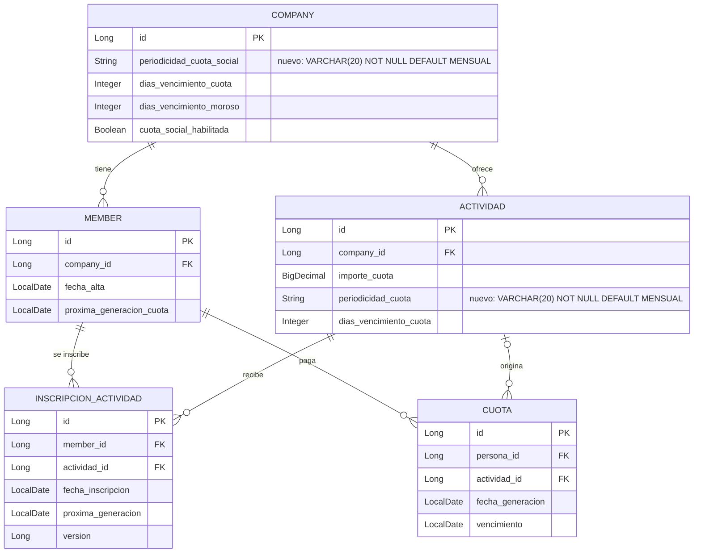
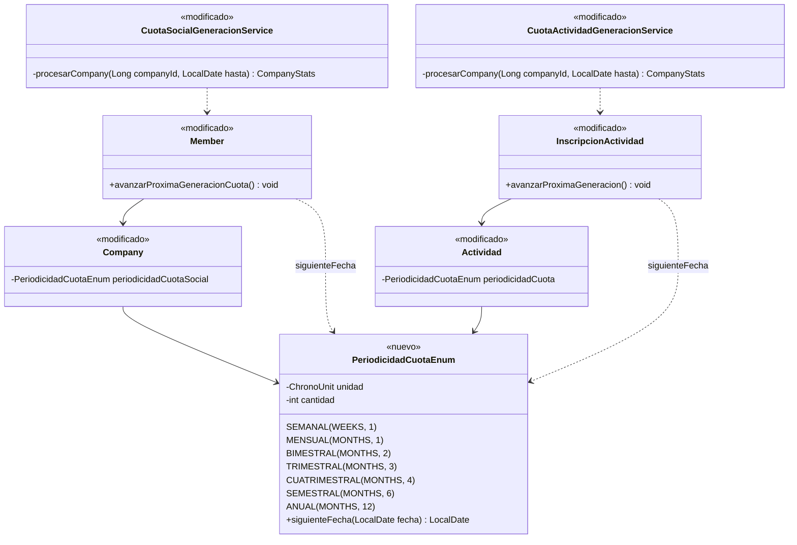

# Periodicidad de cuotas

**Estado:** implementado

## Funcionalidad
**Objetivo:** reemplazar la generación de cuotas cada N días (BS-381) por una periodicidad de calendario. Cada cuota se genera el mismo día del período que la primera: si la primera cuota se generó el 15, las siguientes se generan el 15 de la semana/mes que corresponda según la periodicidad. Así se evita el corrimiento que provoca sumar días fijos (30 días desde el 15/01 cae el 14/02, luego el 16/03, etc.).

**Actores:**
- Admin del club: configura la periodicidad de la cuota social del club y la de cada actividad.
- Jobs de generación (`CuotaSocialGeneracionScheduler`, `CuotaActividadGeneracionScheduler`) y generación manual: generan las cuotas pendientes.
- Alta de socio / inscripción a actividad: generan la primera cuota y fijan el día ancla.

**Reglas de negocio:**
- La periodicidad es un enum `PeriodicidadCuotaEnum`: `SEMANAL`, `MENSUAL`, `BIMESTRAL`, `TRIMESTRAL`, `CUATRIMESTRAL`, `SEMESTRAL`, `ANUAL`.
  - `SEMANAL` avanza 1 semana; el resto avanza 1, 2, 3, 4, 6 y 12 meses respectivamente.
- Dónde se configura:
  - Cuota social: `Company.periodicidadCuotaSocial` reemplaza a `Company.diasEntreGeneraciones`.
  - Cuota de actividad: `Actividad.periodicidadCuota` reemplaza a `Actividad.diasGeneracionCuota`.
- Ya no se guardan días entre generaciones: las columnas `companies.dias_entre_generaciones` y `actividades.dias_generacion_cuota` se eliminan.
- Se mantiene el puntero de próxima generación (`Member.proximaGeneracionCuota`, `InscripcionActividad.proximaGeneracion`) y el loop actual del job: mientras el puntero sea ≤ `hasta`, se genera la cuota de esa fecha y el puntero avanza un período.
- El día de generación lo fija la primera cuota (alta del socio / fecha de inscripción): el puntero arranca en esa fecha y cada avance suma el período a la fecha del puntero, así que las cuotas siguientes caen el mismo día.
  - `SEMANAL` suma 7 días (conserva el día de la semana); el resto suma los meses del período (`plusMonths`).
  - No se guarda un día ancla: si el mes destino no tiene el día del puntero, se usa el último día del mes y el puntero queda en ese día para los períodos siguientes.
- Cambiar la periodicidad de un club o de una actividad no recalcula los punteros: la próxima cuota se sigue generando en la fecha ya pactada y, desde ahí, los avances usan la nueva periodicidad.
- Los días de vencimiento (`Company.diasVencimientoCuota`, `Actividad.diasVencimientoCuota`) no cambian: siguen siendo días desde la fecha de generación.
- API: los commands y DTOs de actividad y de perfil del club reemplazan `diasGeneracionCuota` / `diasEntreGeneraciones` por `periodicidadCuota` / `periodicidadCuotaSocial`. Si no viene en el alta, queda `MENSUAL`; si no viene en la edición, se conserva la actual.
- **Migración:**
  - Todos los clubes y actividades existentes quedan en `MENSUAL`.
  - Los punteros existentes no se mueven (no se saltea ni se duplica ninguna cuota): desde su fecha actual pasan a avanzar por período.

**Casos borde:**
- Primera cuota el 29, 30 o 31 con periodicidad mensual o mayor: al llegar a un mes más corto, la cuota se genera el último día de ese mes y las siguientes quedan en ese día (31/01 → 28/02 → 28/03 → …).
- Alta el 29/02 con `ANUAL`: desde el año siguiente se genera el 28/02.
- Generación atrasada (el job no corrió varios períodos): se generan todas las cuotas adeudadas, una por período, igual que hoy.
- Socio/inscripción existente cuyo puntero quedó corrido por los ciclos de 30 días: sigue desde el día de su puntero actual, no desde el de su alta.
- La UK por `fecha_generacion` (v64) se mantiene como red de seguridad contra duplicados.

**Fuera de alcance:**
- Días de vencimiento de cuota y días de morosidad / inhabilitación.
- Cuotas ya generadas: no se recalculan ni se mueven sus fechas.
- Prorrateo de la primera cuota.
- Conservar el día 29/30/31 después de pasar por un mes más corto.
- Permitir que el admin edite el día de generación de un socio o inscripción.

## Modelo de datos

| Entidad | Cambio |
|---|---|
| COMPANY | modificada: + periodicidad_cuota_social, − dias_entre_generaciones |
| ACTIVIDAD | modificada: + periodicidad_cuota, − dias_generacion_cuota |
| MEMBER | existente, sin cambios (el puntero avanza con la periodicidad del club) |
| INSCRIPCION_ACTIVIDAD | existente, sin cambios (el puntero avanza con la periodicidad de la actividad) |
| CUOTA | existente, sin cambios |

**Valores de la periodicidad** (`PeriodicidadCuotaEnum`, persistido por nombre):

| Enum | Avance |
|---|---|
| SEMANAL | 1 semana |
| MENSUAL | 1 mes |
| BIMESTRAL | 2 meses |
| TRIMESTRAL | 3 meses |
| CUATRIMESTRAL | 4 meses |
| SEMESTRAL | 6 meses |
| ANUAL | 12 meses |

**Migración (v67):**
- `companies`: se agrega `periodicidad_cuota_social VARCHAR(20) NOT NULL DEFAULT 'MENSUAL'` (todos los clubes existentes quedan en `MENSUAL`) y se elimina `dias_entre_generaciones`.
- `actividades`: se agrega `periodicidad_cuota VARCHAR(20) NOT NULL DEFAULT 'MENSUAL'` (todas las actividades existentes quedan en `MENSUAL`) y se elimina `dias_generacion_cuota`.
- `members.proxima_generacion_cuota` e `inscripciones_actividad.proxima_generacion` no se tocan.

## Diseño

| Clase | Método / campo | Cambio |
|---|---|---|
| PeriodicidadCuotaEnum (`Code.Entity.Enums`) | siguienteFecha | nuevo: `fecha.plus(cantidad, unidad)`; con `MONTHS` Java ajusta al último día si el mes destino no tiene ese día |
| Company | periodicidadCuotaSocial | nuevo, `@Enumerated(EnumType.STRING)`, default `MENSUAL`; se elimina `diasEntreGeneraciones` |
| Actividad | periodicidadCuota | nuevo, `@Enumerated(EnumType.STRING)`, default `MENSUAL`; se elimina `diasGeneracionCuota` |
| Member | avanzarProximaGeneracionCuota | modificado: `company.getPeriodicidadCuotaSocial().siguienteFecha(proximaGeneracionCuota)` |
| InscripcionActividad | avanzarProximaGeneracion | modificado: `actividad.getPeriodicidadCuota().siguienteFecha(proximaGeneracion)` |
| CuotaSocialGeneracionService / CuotaActividadGeneracionService | procesarCompany | modificado: se quita el guard de días ≤ 0 (la periodicidad siempre avanza y la columna es NOT NULL) |
| CompanyService | validateClubFields | modificado: se quita la validación de días entre generaciones |
| CompanyDTO, ClubProfileFieldsDTO | diasEntreGeneraciones → periodicidadCuotaSocial | modificado: tipo `PeriodicidadCuotaEnum` (en JSON viaja el nombre, ej. `"MENSUAL"`) |
| ActividadDTO, ActividadAltaCommand, ActividadEdicionCommand | diasGeneracionCuota → periodicidadCuota | modificado: tipo `PeriodicidadCuotaEnum`, opcional |
| CompanyMapper, ActividadMapper | — | modificado: mapean el campo nuevo |
| ActividadAltaService / ActividadEdicionService | — | modificado: setean `periodicidadCuota` si viene en el command |
| openapi.yaml, docs/API.md, postman, tests | — | modificado: campo nuevo en lugar de los días |

```mermaid
sequenceDiagram
    participant J as CuotaSocialGeneracionScheduler
    participant S as CuotaSocialGeneracionService
    participant CR as CompanyRepository
    participant MR as MemberRepository
    participant Q as Cuota
    participant M as Member
    participant P as PeriodicidadCuotaEnum
    participant QR as CuotaRepository
    J->>S: generarHasta(hasta)
    S->>CR: findByCuotaSocialHabilitadaTrueAndStatus(ACTIVE)
    CR-->>S: List~Company~
    loop por cada club
        rect rgb(30, 45, 70)
            Note over S,QR: TransactionTemplate (una transacción por club)
            S->>MR: findConGeneracionCuotaPendiente(companyId, estados, hasta)
            MR-->>S: List~Member~
            loop mientras proximaGeneracionCuota <= hasta
                S->>Q: deSocial(company, persona, fecha, descuentos)
                Q-->>S: Cuota
                S->>M: avanzarProximaGeneracionCuota()
                M->>P: siguienteFecha(proximaGeneracionCuota)
                P-->>M: LocalDate
            end
            S->>QR: saveAll(cuotas)
        end
    end
    S-->>J: CuotaSocialGeneracionResultDTO
```

El flujo de actividad es el mismo con `CuotaActividadGeneracionService`, `InscripcionActividad.avanzarProximaGeneracion()` y `Actividad.getPeriodicidadCuota()`.

## Decisiones
- Día de generación en meses cortos: sin día ancla (opción C) — más simple; se acepta que el 31 quede en 28 tras febrero.
- Origen del día de generación: fecha de la primera cuota (alta / inscripción).
- Punteros existentes en la migración: no se mueven — evita saltear o duplicar cuotas.
- Persistencia de la periodicidad: enum por nombre (`VARCHAR(20)` + `@Enumerated(STRING)`) — legible en la base y sin converter.
- Cambio de periodicidad de actividad/club: aplica a los inscriptos/socios actuales desde su próxima cuota (sin copia en la inscripción) — más simple.
- Días de vencimiento vs período: sin validación cruzada — queda fuera de alcance.
- Cálculo de la próxima fecha: método `siguienteFecha` en el enum, sin helper aparte — la regla de avance vive junto a la periodicidad.
